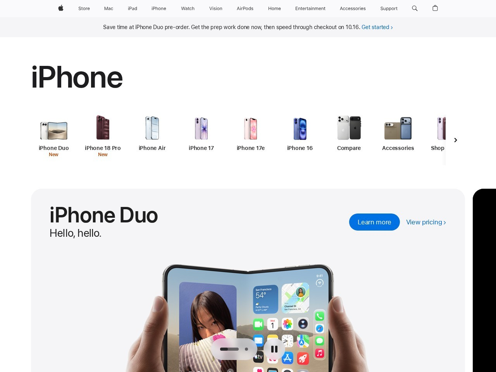

# Phân tích và xây dựng cấu trúc website template

## Trang web được phân tích

- **Trang:** [Apple iPhone](https://www.apple.com/iphone/)
- **Ngày tham khảo:** 18/10/2026
- **Ảnh chụp trang gốc:** [trang-goc-apple-iphone.jpg](images/trang-goc-apple-iphone.jpg)

## Phân tích bố cục

- **Header:** Thanh điều hướng toàn cục ở trên cùng, có logo và các liên kết tới cửa hàng, sản phẩm, hỗ trợ. Nền sáng và nội dung được căn ngang.
- **Navigation Menu:** Bên dưới header có menu riêng cho iPhone. Tên trang nằm bên trái; các mục khám phá, tính năng, so sánh và nút mua nằm bên phải.
- **Content Section:** Mở đầu bằng phần giới thiệu sản phẩm lớn với tiêu đề, mô tả, nút hành động và hình sản phẩm. Khi cuộn xuống, nội dung chia thành các phần về lợi ích, tính năng và dòng sản phẩm; các phần dùng khoảng trắng rộng và hình ảnh nổi bật.
- **Footer:** Cuối trang có ghi chú, các nhóm liên kết hỗ trợ/chính sách và thông tin bản quyền.

## Bản dựng HTML & CSS

`index.html` và `style.css` mô phỏng thứ tự các vùng chính: header, menu sản phẩm, hero, thẻ tính năng và footer. Hình điện thoại trong hero được tạo bằng HTML/CSS để tập trung vào bố cục. CSS Grid chia các thẻ tính năng; media queries điều chỉnh bố cục cho màn hình nhỏ.

Đây là bản thực hành cấu trúc, không phải bản sao pixel-perfect hay trang bán hàng chính thức của Apple.
